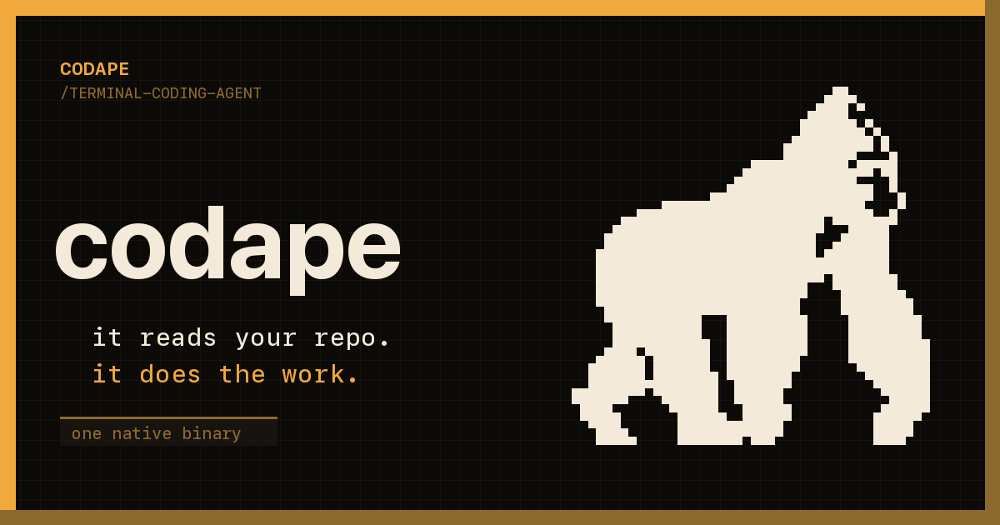

<p align="center">
  
</p>

# Codape

**Codape is a coding agent for your terminal.** It runs a model against your
repository, decides what to do next, and executes it: reading and editing
files, running shell commands, searching code, driving sub-agents, and
carrying the work forward across turns without you re-explaining the task.

It ships as a single native binary, with nothing hosted behind the repository.
Linux (gnu and musl), macOS (Intel and Apple silicon), Windows. Apache-2.0.

[codape.com](https://codape.com) · [Releases](https://github.com/lightconsen/codape/releases) · [Docs](docs/)

## What it does

**It acts.** The agent loop is the product. Codape plans, calls tools, reads
the results and continues until the task is done or it stops for a reason it
can name — rather than emitting a suggestion and handing control back.

**It runs on the models you have.** Anthropic Claude and any OpenAI-compatible
endpoint, configured by environment or settings file, with model, endpoint and
credentials swappable per project.

**It works in the terminal you already use.** A ratatui REPL with Vim
bindings, syntax highlighting and themes; shortcuts you can rebind in
`keybindings.json`; one-shot non-interactive runs for scripts and CI; a server
mode for editors and SDK clients.

## Install

```bash
curl -fsSL https://raw.githubusercontent.com/lightconsen/codape/main/scripts/install.sh | sh
```

The script verifies the download against the release's `SHA256SUMS`. Prebuilt
archives for every supported target are on the
[releases page](https://github.com/lightconsen/codape/releases), or build from
source with Cargo:

```bash
cargo install --git https://github.com/lightconsen/codape.git
```

## Use

```bash
codape                          # interactive REPL in the current directory
codape "add retry to the upload client"   # one prompt, then exit
codape -c                       # continue the most recent session
codape -m claude-sonnet-4-6     # pick a model
codape serve --port 8080        # WebSocket server for editor and SDK clients
codape --agent reviewer "audit the diff on this branch"   # run as a named custom agent
```

## Documentation

The technical reference lives in [docs/](docs/):

| | |
|---|---|
| [Architecture](docs/arch.md) | Crate layout, engine, data flow |
| [CLI reference](docs/cli.md) | Every flag and subcommand |
| [Configuration](docs/config.md) | Settings files, precedence, environment |
| [Permissions](docs/core.md) | Modes and the decision engine |
| [Sandbox](docs/sandbox.md) | Backends, guarantees, escapes |
| [Tools](docs/tools.md) | The tool catalogue and protocol |
| [Commands](docs/commands.md) | Slash command reference |
| [Hooks](docs/hooks.md) | Lifecycle events and hook execution |
| [Sub-agents](docs/agents.md) | Spawning, isolation, messaging |
| [MCP](docs/mcp.md) | Server lifecycle and discovery |
| [Plugins](docs/plugins.md) | WASM and process plugins |
| [Server](docs/server.md) | WebSocket protocol for SDK clients |
| [Build](docs/build.md) | Prerequisites, routes, resource cost |
| [Self-update](docs/self-update.md) | How `codape update` decides and verifies |
| [Benchmarks](docs/benchmark.md) | Agent benchmark harness |
| [Specification](docs/spec.md) | Full design (Chinese) |
| [All docs](docs/) | The full index |

## Contributing

`main` accepts nothing but pull requests, and a change is mergeable only once
the checks in [docs/verification.md](docs/verification.md) pass. Read
[CONTRIBUTING.md](CONTRIBUTING.md) before your first one.

## License

Apache License 2.0 — see [LICENSE](LICENSE). Third-party notices in
[NOTICE](NOTICE).
